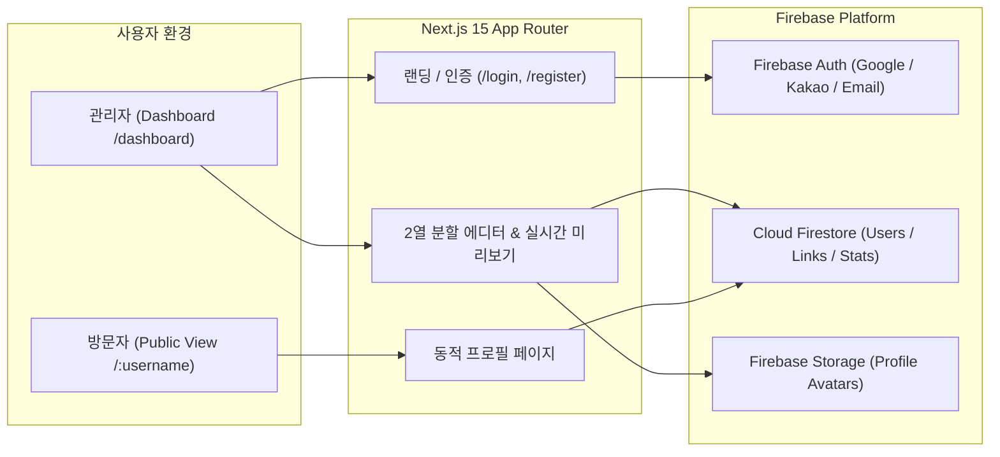
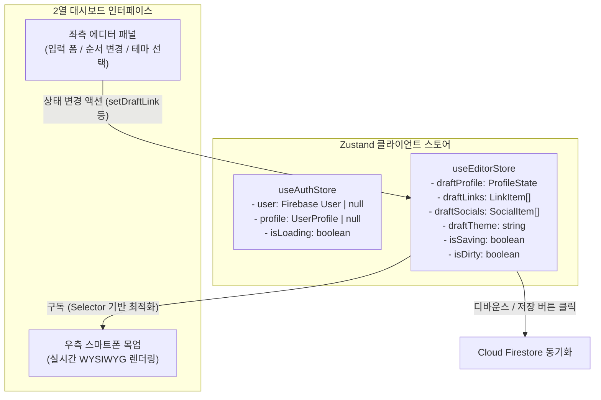
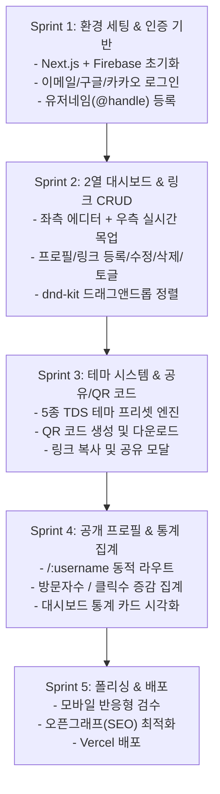

# 📄 [PRD] 마이링크 (My Link) 기능 정의서

> **문서 버전**: v1.0.0  
> **작성일자**: 2026-11-08  
> **프로젝트 유형**: Next.js + Firebase 기반 멀티유저 링크트리(Linktree) 클론 SaaS  
> **디자인 콘셉트**: 토스 디자인 시스템(TDS) 기반의 모던·미니멀 UI  

---

## 1. 프로젝트 개요 (Overview)

### 1.1 서비스 정의
**'마이링크(My Link)'**는 인플루언서, 대학생, 창작자, 1인 사업자 등 다양한 사용자가 자신의 모든 링크(SNS, 포트폴리오, 블로그, 외부 사이트 등)를 단 하나의 직관적인 모바일 친화형 프로필 페이지(`/[username]`)에 모아두고 손쉽게 공유할 수 있는 **멀티유저 링크 인 바이오(Link-in-bio) SaaS 플랫폼**입니다.

### 1.2 기획 배경 및 핵심 가치
- **원스톱 링크 제공**: 인스타그램 등 프로필에 단 1개의 URL만 등록 가능한 SNS의 제약을 극복합니다.
- **실시간 편집 경험**: 좌측 편집 패널에서 수정하는 즉시 우측의 가상 스마트폰 목업에서 실시간 반영되는 WYSIWYG 형태의 직관적인 사용자 경험(UX)을 제공합니다.
- **신뢰와 미니멀리즘**: 토스 디자인 시스템(TDS) 감성의 정돈된 UI와 인터랙션을 기본으로 채택하여 가독성과 심미성을 극대화합니다.
- **성장 분석**: 총 방문자 수와 링크별 클릭 수를 추적하여 어떤 콘텐츠가 가장 인기 있는지 확인할 수 있습니다.

---

## 2. 시스템 아키텍처 및 기술 스택 (Tech Stack)



| 구분 | 기술 스택 | 선정 사유 |
| :--- | :--- | :--- |
| **Frontend Framework** | **Next.js 15 (App Router)** | 서버 컴포넌트(RSC)를 활용한 빠른 초기 로딩 및 동적 라우팅(`/[username]`) 지원 |
| **Language** | **TypeScript** | 안정적인 타입 안전성 및 개발 생산성 향상 |
| **Styling** | **Tailwind CSS** | 빠르고 일관된 유틸리티 퍼스트 스타일링 및 디자인 토큰 연동 |
| **Design System** | **TDS (Toss Design System) Guideline** | 심플하고 직관적인 한국형 미니멀 UI/UX 구현 (`design.md` 토큰 활용) |
| **Auth** | **Firebase Authentication** | 구글 간편로그인, 카카오 소셜 로그인, 이메일/비밀번호 인증 원스톱 지원 |
| **Database** | **Cloud Firestore** | NoSQL 실시간 문서형 데이터베이스로 빠른 CRUD 및 실시간 동기화 지원 |
| **Storage** | **Firebase Storage** | 프로필 이미지(아바타) 업로드 및 CDN 서빙 |
| **State Management** | **Zustand** | 2열 대시보드(좌측 에디터 ↔ 우측 목업 프리뷰) 간 초경량(~1KB) 실시간 전역 상태 동기화 |
| **Libraries** | `@dnd-kit/core`, `@dnd-kit/sortable`<br>`qrcode.react`<br>`lucide-react`<br>`canvas-confetti` | 드래그 앤 드롭 정렬, QR 코드 생성, 일관된 아이콘셋, 인터랙션 효과 |

### 2.1 전역 상태 관리 설계 (Zustand Architecture)
Next.js 15 App Router 환경에서 보일러플레이트를 최소화하고, 클라이언트 컴포넌트 간 반응형 렌더링 성능을 극대화하기 위해 **Zustand**를 채택합니다.



- **`useAuthStore`**: 현재 로그인된 Firebase 사용자 정보 및 인증 로딩 상태 관리
- **`useEditorStore`**: 좌측 에디터와 우측 모바일 목업 간의 실시간 연동 담당
  - 폼 입력 시 우측 목업이 0ms 지연으로 즉각 반응
  - 낙관적 업데이트(Optimistic Update) 적용으로 드래그 정렬 시 끊김 없는 UX 제공
  - Firestore 쓰기 요청 최소화를 위한 디바운스(Debounce) 및 저장 핸들링

---

## 3. 사이트 구조 및 사용자 시나리오 (Site Map & User Scenarios)

### 3.1 사이트 맵
```
/ (Landing Page)
├── /login (로그인 페이지)
├── /register (회원가입 페이지 - 핸들/유저네임 중복확인)
├── /dashboard (관리자 통합 대시보드 - 2열 분할 에디터)
│   ├── [기능 탭] 프로필 설정 / 링크 관리 / 테마 선택 / 통계 분석
│   └── [모달] 링크 공유 & QR 코드 다운로드
└── /[username] (사용자 공개 프로필 페이지 - 반응형 모바일 최적화 뷰)
```

### 3.2 상세 사용자 시나리오 (User Scenarios)

#### 👥 타깃 페르소나 (User Personas)
| 페르소나 | 대상 인물 | 주요 니즈 & 행동 패턴 |
| :--- | :--- | :--- |
| **Persona A: 창작자/인플루언서** | **김민지 (22세, 일러스트레이터)** | 인스타그램 단일 프로필 링크의 한계 극복. 연재처, 굿즈 스토어, 방명록 등 멀티 링크를 예쁘고 정돈된 토스 감성으로 보여주고 싶음. |
| **Persona B: 취업 준비생/개발자** | **이준호 (24세, 컴퓨터공학 전공)** | 이력서, 깃허브, 테크 블로그, 노션 포트폴리오를 하나의 링크(`/@junho.dev`)로 묶어 명함이나 채용 플랫폼에 제출하고 클릭 현황을 알고 싶음. |
| **Persona C: 로컬 1인 소상공인** | **박지은 (32세, 베이커리 카페 대표)** | 네이버 스마트플레이스, 인스타 라인업, 카카오톡 채널 예약 운영. 메뉴 품절 시 링크를 지우지 않고 잠깐 꺼두는(Off) 기능과 테이블 부착용 QR 코드가 필수. |
| **Persona D: 모바일 일반 방문자** | **최수연 (21세, 인스타그램 유저)** | SNS를 보다가 프로필 링크를 눌렀을 때 렉 없이 빠르게 열리고, 군더더기 없이 원하는 링크로 바로 넘어가는 네이티브 앱 같은 UX를 선호. |

---

#### 🎯 [핵심 시나리오 1] 신규 크리에이터의 첫 링크트리 개설 (온보딩)
- **주인공**: 김민지 (Persona A)
- **상황 및 목표**: 인스타그램 프로필에 등록할 나만의 포트폴리오 링크 페이지를 3분 만에 개설하기
- **단계별 플로우**:
  1. 랜딩 페이지(`/`)에서 `3분 만에 무료로 시작하기` CTA 버튼을 클릭한다.
  2. `카카오로 시작하기`를 눌러 별도의 복잡한 회원가입 양식 없이 1초 만에 간편 로그인을 마친다.
  3. 온보딩 모달에서 내 고유 링크 주소로 사용할 유저네임(핸들) 입력창에 `minji_art`를 입력한다.
  4. 클라이언트가 Firestore 인덱스를 확인하여 `사용 가능한 멋진 링크입니다! ✨` 초록색 뱃지를 실시간으로 표시한다.
  5. `시작하기` 버튼을 누르면 초기 템플릿 데이터가 생성되며 `/dashboard` 에디터 화면으로 자동 진입한다.
- **시스템 동작**:
  - `users` 및 `usernames` 컬렉션에 새 문서 생성
  - 환영 튜토리얼 툴팁 노출 및 `useAuthStore`, `useEditorStore` 초기화

---

#### 🎯 [핵심 시나리오 2] 링크 추가·수정 및 순서 변경 (일상적인 링크 관리)
- **주인공**: 김민지 (Persona A)
- **상황 및 목표**: 새로 연재를 시작한 네이버웹툰 링크와 스마트스토어 굿즈 링크를 상단에 배치하기
- **단계별 플로우**:
  1. 좌측 에디터 패널의 **[+ 새 링크 추가]** 버튼을 누른다.
  2. 타이틀에 `네이버웹툰: 꺄륵이의 하루하루`, URL에 `https://comic.naver.com/...`를 입력한다.
  3. 입력하는 즉시 우측 스마트폰 목업에 TDS 카드 스타일의 링크 버튼이 0ms 지연으로 실시간 렌더링된다.
  4. 기존에 등록해 둔 `개인 블로그` 링크보다 `신작 웹툰` 링크를 더 눈에 띄게 만들기 위해, 링크 카드의 좌측 점박이 핸들을 잡고 맨 위로 드래그한다.
  5. `@dnd-kit`의 부드러운 애니메이션과 함께 카드가 재배치되고, 우측 목업의 순서도 즉시 스왑된다.
  6. 하단에 `저장 완료` 토스트가 뜨며 Firestore의 `order` 필드가 백그라운드에서 자동 갱신된다.
- **시스템 동작**:
  - `useEditorStore`의 `draftLinks` 순서 업데이트 (Optimistic UI)
  - 500ms 디바운스 후 Firestore 배치 쓰기(Batch Write) 실행

---

#### 🎯 [핵심 시나리오 3] 브랜드 맞춤 테마 커스터마이징 & 온/오프라인 홍보
- **주인공**: 김민지 (Persona A)
- **상황 및 목표**: 차분한 화이트 톤에서 시그니처 블루 톤으로 테마를 바꾸고 오프라인 부스용 QR 코드 출력하기
- **단계별 플로우**:
  1. 대시보드의 **[테마]** 탭을 클릭하여 제공되는 5종의 프리셋을 확인한다.
  2. `토스 블루` 프리셋을 선택하자, 우측 모바일 목업의 배경이 시원한 Toss Blue로 전환되고 버튼이 세련된 반투명 글래스모피즘 카드로 변경된다.
  3. 대시보드 우측 상단의 **[공유하기]** 버튼을 누른다.
  4. 모달에서 `링크 복사`를 누르면 클립보드에 `https://mylink.hy/@minji_art`가 복사되고 토스트 안내가 뜬다. (인스타 프로필 링크에 등록)
  5. 오프라인 전시 부스 탁상용 아크릴 스탠드에 넣기 위해 **[QR 코드 이미지 다운로드]**를 눌러 고해상도 PNG 파일(`mylink-minji_art-qr.png`)을 내려받는다.
- **시스템 동작**:
  - `themeId: 'theme-toss-blue'` 상태 저장
  - `qrcode.react` 캔버스를 `toDataURL()`로 변환하여 브라우저 다운로드 트리거

---

#### 🎯 [핵심 시나리오 4] 외부 방문자의 프로필 열람 및 통계 수집 (방문자 & 통계)
- **주인공**: 최수연 (Persona D, 방문자) & 김민지 (Persona A, 관리자)
- **상황 및 목표**: 인스타그램을 둘러보던 팬이 민지의 프로필 링크를 열람하고 웹툰을 감상
- **단계별 플로우**:
  1. 수연이 인스타그램 프로필의 `mylink.hy/@minji_art` 링크를 탭한다.
  2. 0.5초 이내에 민지의 프로필 사진, 한 줄 소개, SNS 아이콘, 링크 카드들이 TDS 특유의 정돈된 인터랙션과 함께 나타난다.
  3. 수연이 첫 번째 링크 카드인 `네이버웹툰: 꺄륵이의 하루하루`를 터치한다.
  4. 버튼이 살짝 눌리는 마이크로 인터랙션(`scale: 0.98`)과 함께 새 탭/앱으로 네이버웹툰 뷰어가 열린다.
  5. 민지는 대시보드 통계 카드에서 오늘 방문자 수가 1 증가하고, 웹툰 링크의 누적 클릭수가 `👁 1회 클릭`으로 실시간 반영된 것을 확인한다.
- **시스템 동작**:
  - 페이지 로드시: Firestore `users/{uid}`의 `totalViews` 원자적 증가 (`FieldValue.increment(1)`)
  - 링크 클릭시: `navigator.sendBeacon` 또는 Firestore `links/{linkId}`의 `clickCount` +1 증가 후 `window.open` 실행

---

#### 📱 [심화 시나리오 5] 모바일 환경에서의 이동 중 대시보드 편집 (Mobile-First Dashboard)
- **주인공**: 이준호 (Persona B, 취준생)
- **상황 및 목표**: 지하철 이동 중 스마트폰으로 긴급히 새로운 프로젝트 깃허브 링크를 프로필에 추가하기
- **단계별 플로우**:
  1. 모바일 크롬 브라우저로 `mylink.hy/dashboard`에 접속한다.
  2. 화면 폭이 좁은 모바일 특성에 맞춰, 우측 목업은 숨겨지고 좌측 에디터 패널이 전체 화면에 최적화되어 표시된다.
  3. 화면 하단에 고정된 **[👁 실시간 미리보기]** 플로팅 바텀 버튼이 노출된다.
  4. `+ 새 링크 추가`를 눌러 `AI 프로젝트 깃허브`와 URL을 입력한다.
  5. 하단 플로팅 버튼을 누르면 iOS 스타일의 바텀시트 모달이 올라오며, 실제 방문자에게 보일 모바일 화면을 즉시 확인할 수 있다.
  6. 모달을 아래로 쓸어내려 닫은 뒤 안심하고 면접관에게 링크를 전송한다.
- **시스템 동작**:
  - Tailwind 미디어 쿼리(`lg:grid-cols-2`) 기반 반응형 레이아웃 분기
  - 모바일에서는 Slide-over / Bottom Sheet 형태로 프리뷰 모달 렌더링

---

#### 🏪 [심화 시나리오 6] 소상공인의 영업 마감 및 품절 링크 임시 숨김 (On/Off 토글)
- **주인공**: 박지은 (Persona C, 베이커리 대표)
- **상황 및 목표**: 당일 소금빵이 조기 품절되어, 배달의민족 주문 링크를 지우지 않고 퇴근 전까지 숨겨두기
- **단계별 플로우**:
  1. 지은이 매장 마감 중 스마트폰으로 마이링크 대시보드에 접속한다.
  2. 링크 목록에서 `배달의민족 주문하기` 카드를 찾는다.
  3. 카드 우측의 초록색 **[활성화 스위치(Toggle)]**를 탭하여 회색(Off)으로 끈다.
  4. 우측 미리보기를 열어보니 방문자 프로필에서 해당 버튼이 즉시 사라진 것을 확인한다. (삭제가 아니므로 클릭 통계와 URL은 그대로 보존됨)
  5. 다음 날 아침 새 빵이 구워졌을 때 스위치를 다시 켜기만 하면 1초 만에 배달 링크가 복원된다.
- **시스템 동작**:
  - `links/{linkId}`의 `isActive: false` 업데이트
  - 공개 프로필 페이지 쿼리 시 `where("isActive", "==", true)` 조건으로 자동 필터링

---

#### ⚠️ [예외 시나리오 7] 유저네임 중복 및 형식 오류 처리 (Form Validation)
- **주인공**: 신규 사용자
- **상황 및 목표**: 이미 다른 사람이 쓰고 있는 유저네임이나 지원하지 않는 특수문자 입력 시 대응
- **단계별 플로우**:
  1. 가입 후 핸들 설정 창에 `link`라는 흔한 단어를 입력한다.
  2. 입력창 아래에 붉은색 텍스트로 `❌ 이미 사용 중인 링크 주소입니다. 다른 주소를 입력해주세요.`라는 에러 메시지와 함께 흔들리는 셰이크(Shake) 애니메이션이 발생한다.
  3. 대안으로 `link_2026`을 입력하자 즉시 `✅ 사용 가능한 링크 주소입니다!` 녹색 체크로 전환된다.
  4. 만약 한글이나 공백(`내 링크`)을 입력하면 `영문 소문자, 숫자, 밑줄(_)만 3~20자 사이로 입력 가능합니다`라는 가이드가 즉각 표시된다.
- **시스템 동작**:
  - 정규식 `/^[a-z0-9_]{3,20}$/` 클라이언트 실시간 검증
  - 디바운스(300ms) 적용하여 Firestore `usernames/{username}` 문서 존재 여부 단 1회 룩업

---

#### 🚫 [예외 시나리오 8] 존재하지 않는 프로필 접근 (404 Not Found & 온보딩 유도)
- **주인공**: 일반 웹 서퍼
- **상황 및 목표**: 오타가 난 주소(`mylink.hy/@unknown_user`)로 접속했을 때의 이탈 방지
- **단계별 플로우**:
  1. 사용자가 오타가 있는 URL로 접근한다.
  2. 브라우저의 기본 딱딱한 404 화면 대신, 토스 감성의 귀여운 그래픽과 함께 `찾으시는 마이링크 페이지가 없어요`라는 친절한 안내 화면이 나타난다.
  3. 하단에 `혹시 주소가 바뀌었거나 삭제되었을 수 있어요`라는 보조 설명이 제공된다.
  4. 그 아래에 파란색의 시인성 높은 **[나도 3분 만에 마이링크 만들기]** CTA 버튼이 있어, 이탈하지 않고 신규 회원으로 유입되도록 유도한다.
- **시스템 동작**:
  - Next.js `not-found.tsx` 또는 `getUserProfile()` null 반환 시 커스텀 404 컴포넌트 렌더링
  - 서비스 브랜드 인지도 향상 및 신규 사용자 획득 퍼널(Funnel)로 전환

---

---

## 4. 상세 기능 명세 (Functional Requirements)

### F-01: 회원가입 및 사용자 인증 (Authentication)
| 요구사항 ID | 기능명 | 상세 내용 | 우선순위 |
| :--- | :--- | :--- | :---: |
| **F-01-1** | 간편 소셜 로그인 | Google 및 Kakao OAuth 팝업/리다이렉트 로그인 지원 | P0 (필수) |
| **F-01-2** | 이메일/비밀번호 가입 | 이메일 유효성 검사, 6자리 이상 비밀번호 규칙 적용 | P0 (필수) |
| **F-01-3** | 핸들(Username) 등록 | 영문 소문자, 숫자, 언더스코어(_) 3~20자 허용, 실시간 중복 체크 | P0 (필수) |
| **F-01-4** | 세션 및 접근 제어 | 미로그인 사용자의 `/dashboard` 접근 시 `/login`으로 리다이렉트 | P0 (필수) |

---

### F-02: 프로필 정보 관리 (Profile Management)
| 요구사항 ID | 기능명 | 상세 내용 | 우선순위 |
| :--- | :--- | :--- | :---: |
| **F-02-1** | 프로필 사진 업로드 | 최대 5MB의 이미지(JPG/PNG/WEBP) 업로드 지원, Firebase Storage 연동, 원형 크롭 미리보기 | P0 (필수) |
| **F-02-2** | 기본 프로필 삭제 | 프로필 이미지를 제거하고 기본 이니셜 아바타로 복원하는 기능 | P1 |
| **F-02-3** | 표시 이름 (Display Name) | 최대 30자 이내 닉네임 설정 (기본값: 가입 시 이름) | P0 (필수) |
| **F-02-4** | 한 줄 소개 (Bio) | 최대 100자 이내의 소개글 입력 지원 (개행 지원 또는 간결한 텍스트) | P0 (필수) |

---

### F-03: 링크 & SNS 블록 관리 (Links & Socials CRUD)
| 요구사항 ID | 기능명 | 상세 내용 | 우선순위 |
| :--- | :--- | :--- | :---: |
| **F-03-1** | 링크 추가/수정/삭제 | 링크 제목(Title), 연결 URL 입력 및 유효성(http/https) 검증 | P0 (필수) |
| **F-03-2** | 활성화 토글 (On/Off) | 삭제하지 않고 일시적으로 프로필 화면에서 숨길 수 있는 스위치 토글 | P0 (필수) |
| **F-03-3** | 드래그 앤 드롭 정렬 | `@dnd-kit`을 이용하여 링크 카드를 드래그하여 순서 재배치 (Firestore `order` 필드 갱신) | P0 (필수) |
| **F-03-4** | SNS 아이콘 그룹 | 인스타그램, 유튜브, 트위터(X), 깃허브, 틱톡, 카카오톡 채널 등 주요 플랫폼 URL 등록 및 자동 아이콘 매핑 | P0 (필수) |

---

### F-04: 2열 분할 대시보드 & 실시간 프리뷰 (Dashboard & Live Preview)
| 요구사항 ID | 기능명 | 상세 내용 | 우선순위 |
| :--- | :--- | :--- | :---: |
| **F-04-1** | 2열 분할 레이아웃 | 데스크톱(1024px 이상): 좌측(에디터 패널, 60%), 우측(스마트폰 목업 고정, 40%)<br>모바일/태블릿: 하단 '미리보기' 플로팅 버튼을 통해 풀스크린 모달로 확인 | P0 (필수) |
| **F-04-2** | 반응형 모바일 목업 | 실제 스마트폰(아이폰 형태의 둥근 모서리와 노치/아일랜드 디자인) 목업 안에 프로필 실시간 렌더링 | P0 (필수) |
| **F-04-3** | 실시간 렌더링 동기화 | 좌측 입력 폼 변경 시 상태가 즉각적으로 우측 목업에 지연 없이 반영 | P0 (필수) |

---

### F-05: 테마 프리셋 시스템 (Theme Presets)
토스 디자인 시스템(TDS) 감성을 기반으로 하며, 버튼 라운딩 및 배경 스타일을 선택할 수 있는 **5종의 프리셋**을 제공합니다.

| 테마 ID | 테마 명칭 | 배경 스타일 | 버튼 스타일 | 텍스트/강조색 |
| :--- | :--- | :--- | :--- | :--- |
| `theme-toss-clean` (기본) | **토스 클래식** | `#F9FAFB` (Grey-50) | 백색 카드 (`#FFFFFF`) + 미세 테두리, 라운드 16px | 텍스트: Grey-900, 포인트: Toss Blue (`#3182F6`) |
| `theme-toss-blue` | **토스 블루** | `#3182F6` (Toss Blue 단색) | 반투명 백색 글래스모피즘 (`rgba(255,255,255,0.18)`), 필(Pill) 라운드 | 텍스트: White, 포인트: White |
| `theme-dark-modern` | **다크 미니멀** | `#191F28` (Grey-900) | 딥그레이 카드 (`#2B3441`), 라운드 12px | 텍스트: White, 포인트: Toss Blue |
| `theme-warm-latte` | **웜 라떼** | `#F7F4EB` (따뜻한 아이보리) | 크림 화이트 (`#FFFFFF`) + 브라운 섀도우, 라운드 16px | 텍스트: Deep Brown (`#3D352E`), 포인트: Coral |
| `theme-lavender-soft` | **라벤더 소프트** | `#F3F0FF` (은은한 라벤더) | 퓨어 화이트 (`#FFFFFF`) + 보라빛 그림자, 라운드 20px | 텍스트: Dark Purple (`#2E1A47`), 포인트: Purple |

---

### F-06: 통계 및 분석 (Basic Analytics)
| 요구사항 ID | 기능명 | 상세 내용 | 우선순위 |
| :--- | :--- | :--- | :---: |
| **F-06-1** | 총 프로필 방문수 | `/[username]` 페이지 로드 시 Firestore 유저 통계의 `totalViews` 원자적 증가 (`FieldValue.increment(1)`) | P0 (필수) |
| **F-06-2** | 링크별 클릭수 | 사용자가 링크 카드 클릭 시 백그라운드로 `clickCount` 증가 API/이벤트 전송 후 외부 링크 새 탭 이동 | P0 (필수) |
| **F-06-3** | 대시보드 통계 카드 | 대시보드 상단에 2개의 핵심 지표 카드(누적 방문자 수, 총 링크 클릭 수) 노출 | P0 (필수) |
| **F-06-4** | 개별 링크 클릭수 표시 | 좌측 링크 목록 각 카드 우측에 `👁 128회 클릭` 형태로 직관적 표시 | P0 (필수) |

---

### F-07: 링크 복사, 공유 및 QR 코드 기능 (Share & QR Code)
| 요구사항 ID | 기능명 | 상세 내용 | 우선순위 |
| :--- | :--- | :--- | :---: |
| **F-07-1** | URL 클립보드 복사 | 상단 `링크 복사` 버튼 클릭 시 `navigator.clipboard.writeText()`로 복사 및 토스 스타일 토스트 알림 표시 | P0 (필수) |
| **F-07-2** | QR 코드 자동 생성 | `qrcode.react`를 활용하여 사용자 고유 URL에 대한 고화질 QR 코드 생성 | P0 (필수) |
| **F-07-3** | QR 코드 이미지 다운로드 | 생성된 QR 코드를 PNG 이미지 파일(`mylink-minji-qr.png`)로 원클릭 저장 | P0 (필수) |
| **F-07-4** | SNS 공유하기 | Web Share API (`navigator.share`) 지원 (미지원 브라우저는 링크 복사 대체) | P1 |

---

### F-08: 공개 링크 페이지 (`/[username]`)
| 요구사항 ID | 기능명 | 상세 내용 | 우선순위 |
| :--- | :--- | :--- | :---: |
| **F-08-1** | 모바일 최적화 뷰 | 중앙 480px 컨테이너에 정렬된 깨끗한 모바일 맞춤 레이아웃 | P0 (필수) |
| **F-08-2** | 동적 메타태그 (SEO / OG) | 사용자의 닉네임, 프로필 사진, 한 줄 소개를 반영한 오픈그래프(og:title, og:image, og:description) 자동 생성 | P0 (필수) |
| **F-08-3** | 빠른 로딩 & 에러 처리 | 존재하지 않는 사용자 접근 시 토스 스타일의 친절한 404 안내 페이지 표시 | P0 (필수) |

---

## 5. 데이터베이스 스키마 설계 (Cloud Firestore Schema)

```
[Firestore Root]
├── users (Collection)
│   └── {uid} (Document)
│       ├── uid: string (Firebase Auth UID)
│       ├── email: string
│       ├── username: string (Unique handle, e.g. "minji")
│       ├── displayName: string (e.g. "김민지")
│       ├── bio: string
│       ├── avatarUrl: string | null
│       ├── themeId: string (e.g. "theme-toss-clean")
│       ├── totalViews: number (방문 카운트)
│       ├── createdAt: Timestamp
│       └── updatedAt: Timestamp
│
├── usernames (Collection: 유저네임 중복 방지 인덱스)
│   └── {username} (Document)
│       └── uid: string
│
├── links (Collection)
│   └── {linkId} (Document)
│       ├── id: string
│       ├── userId: string (Owner UID)
│       ├── title: string
│       ├── url: string
│       ├── isActive: boolean
│       ├── order: number (정렬 순서)
│       ├── clickCount: number
│       ├── createdAt: Timestamp
│       └── updatedAt: Timestamp
│
└── socials (Collection)
    └── {socialId} (Document)
        ├── id: string
        ├── userId: string
        ├── platform: "instagram" | "youtube" | "twitter" | "github" | "tiktok" | "kakao"
        ├── url: string
        ├── order: number
        └── updatedAt: Timestamp
```

---

## 6. 디자인 가이드라인 (TDS - Toss Design System 스타일)

- **주요 색상 토큰**:
  - `Brand Primary`: `#3182F6` (Toss Blue)
  - `Text Primary`: `#191F28` (Grey-900)
  - `Text Secondary`: `#4E5968` (Grey-700)
  - `Background`: `#F9FAFB` (Grey-50)
  - `Surface (Card)`: `#FFFFFF` (White)
  - `Border / Divider`: `#E5E8EB` (Grey-200)
- **타이포그래피**:
  - `Pretendard` 또는 `Geist Sans` 폰트 적용
  - 명확한 계층 구조: 제목 20~24px Bold, 본문 15~16px Medium, 캡션 12~13px Regular
- **컴포넌트 특징**:
  - 버튼/카드 둥근 모서리: `rounded-2xl` (16px) 또는 `rounded-3xl` (24px)
  - 클릭/터치 반응: 누를 때 살짝 축소되는 마이크로 인터랙션 (`active:scale-[0.98] transition-all`)
  - 토스트/모달: 부드러운 페이드인 및 스프링 애니메이션

---

## 7. 개발 로드맵 및 마일스톤 (Roadmap)



| 단계 | 목표 | 산출물 | 예상 기간 |
| :--- | :--- | :--- | :---: |
| **Sprint 1** | 인프라 설정 및 회원 인증 시스템 | Firebase Auth 연동, `/login`, `/register`, 유저네임 중복체크 | 1주차 |
| **Sprint 2** | 대시보드 2열 뷰 및 링크 CRUD | 에디터 패널, 모바일 목업 프리뷰, 링크/SNS 등록 및 드래그 정렬 | 2주차 |
| **Sprint 3** | 테마 프리셋 & QR/공유 기능 | 5종 테마 적용 엔진, 클립보드 복사, QR코드 다운로드 | 3주차 |
| **Sprint 4** | 공개 페이지(`/[username]`) & 통계 | 동적 라우트 프로필 뷰, 방문자/클릭수 트래킹, 대시보드 통계 카드 | 4주차 |
| **Sprint 5** | 반응형 최적화, SEO 및 최종 배포 | Vercel 배포, 오픈그래프 메타태그, 성능 최적화 | 5주차 |

---

## 8. 향후 확장 고려사항 (Post-MVP Backlog)
1. **커스텀 도메인 연동**: 사용자의 개인 도메인(예: `link.minji.me`) 매핑
2. **커스텀 배경 이미지 & 애니메이션 효과**: 사용자 직접 배경 업로드
3. **상세 분석 대시보드**: 일별 방문 그래프, 유입 경로(인스타그램, 유튜브 등 레퍼러) 분석
4. **후원 및 결제 링크**: 토스페이 / 카카오페이 / 커피 후원 연동
